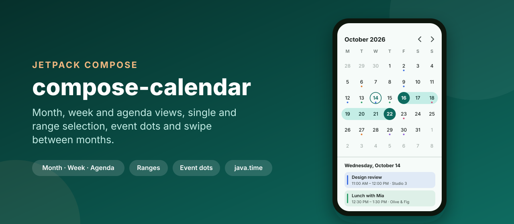
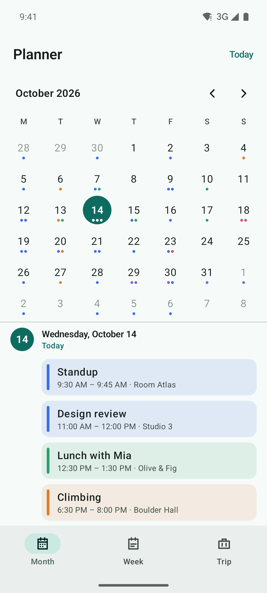
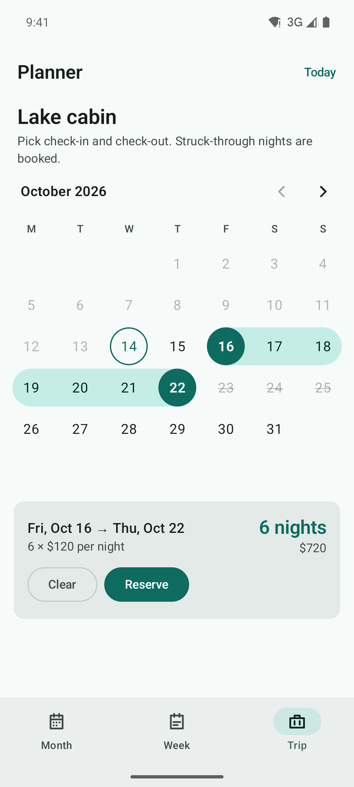
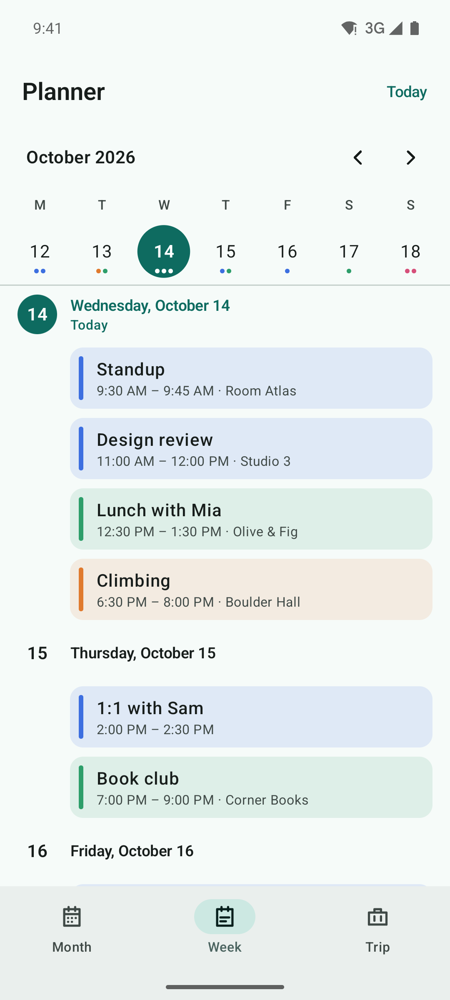
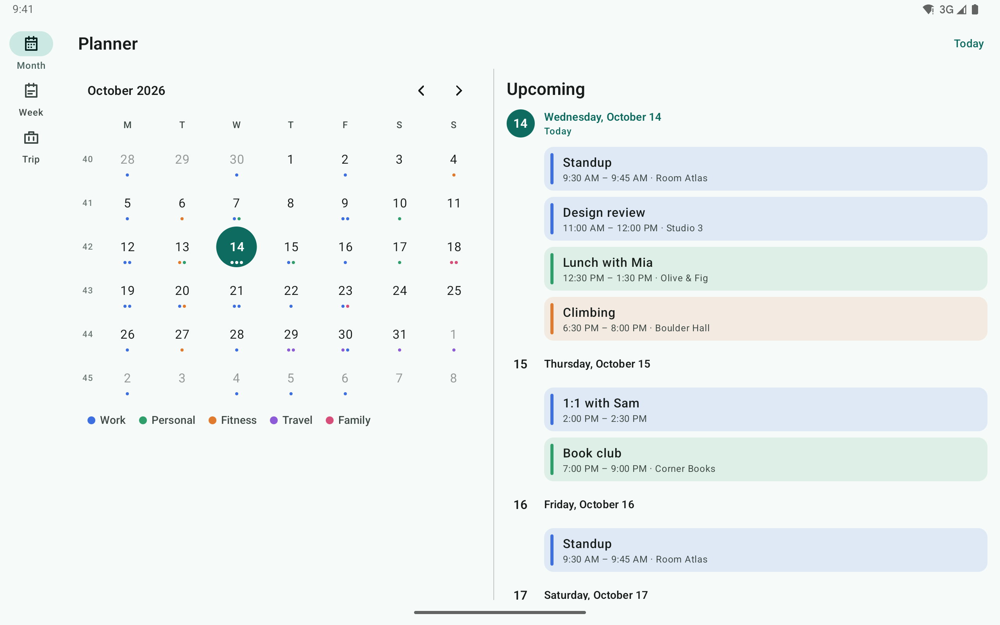

<p align="center">
  
</p>

<p align="center">
  <a href="https://github.com/halilozel1903/compose-calendar/actions/workflows/ci.yml"></a>
  <a href="https://jitpack.io/#halilozel1903/compose-calendar"></a>
  
  
  
  
  <a href="LICENSE"></a>
</p>

**compose-calendar** is a calendar for Jetpack Compose with month, week and agenda views. `MonthCalendar` swipes between months in a pager, `WeekCalendar` is a one-week strip that swipes between weeks, and `AgendaList` lists days with sticky headers and their events. Dates can be selected one at a time, several at once or as a range drawn as a continuous pill, with bounds, disabled dates and minimum and maximum range lengths. Days show up to three event dots, any day cell can be replaced through a slot, and the first day of the week follows the locale or your choice. Everything is built on `java.time` and a small pure Kotlin core with unit tests.

```kotlin
val state = rememberCalendarState(selectionMode = SelectionMode.Single)
val events = remember { EventIndex.ofEvents(myEvents) }
val dots = rememberEventDots(events) { event -> event.color?.let(::Color) }

MonthCalendar(state = state, eventDots = dots)

val day = state.selectedDate ?: state.today
AgendaList(days = Agenda.build(events, from = day, to = day.plusDays(30)), today = state.today)
```

## Screenshots

Captured from the sample app (Planner, a small calendar app fixed to Wednesday, 14 October 2026) on Android emulators by CI. Each scene opens with the calendar already settled, so nothing is captured mid-animation.

| Month with event dots | Range selection | Week strip and agenda |
| :---: | :---: | :---: |
|  |  |  |

**Tablet:** on a Pixel Tablet in landscape the Planner shows the month with ISO week numbers next to the upcoming agenda.



## Features

- **Month view**: `MonthCalendar` with a `HorizontalPager` per month, a header with the month title and arrows, weekday labels, optional ISO 8601 week numbers, and the previous and next month's days shown dimmed or hidden (`OutsideDays`). Every month has six rows by default (`GridRows.Six`), so the calendar keeps its height while swiping; `GridRows.Fit` uses only the rows a month needs.
- **Week view**: `WeekCalendar`, a one-week strip with its own pager over the same months. It swipes to the selected date's week when the selection changes elsewhere (from a month view on the same screen or from code).
- **Agenda**: `AgendaList` with a sticky header per day, events under it and an optional "No events" row for empty days. `Agenda.build` makes the days, `scrollToAgendaDate` scrolls to a date. Ready-made rows for `CalendarEvent` show a color bar, the time (or "All day", or "Day 2 of 3" for multi-day events) and the location.
- **Selection**: `SelectionMode.Single`, `Multiple` and `Range`. The first tap of a range sets the start and the second the end; a tap before the start moves the start, and a tap after a complete range starts a new one.
- **Rules**: `SelectionRules` with `minDate`, `maxDate`, `disabledDates`, any `isDisabled` predicate, `minRangeDays`, `maxRangeDays`, `allowDisabledInRange` and `maxSelectedDates`. A rejected tap leaves the selection as it is and tells you why (`SelectionResult.Rejected` with a `SelectionRejection`).
- **Range pill**: the range is drawn as one continuous shape, rounded at its ends and where it wraps to the next row, with filled circles on the start and end. Right-to-left layouts are mirrored.
- **Event dots**: up to three dots per day in each event's color; `rememberEventDots` builds them from an `EventIndex`. Dots on a filled circle take the circle's content color so they stay visible.
- **Day content slot**: replace what a day shows (`dayContent`); the cell still draws the selection, range pill and today ring and sets `LocalContentColor`.
- **First day of the week**: from the locale by default (Sunday in the US, Monday in most of Europe) or any `DayOfWeek`.
- **State that survives**: `rememberCalendarState` saves the visible month, the visible week and the selection across rotation and process death.
- **Accessibility**: each day reads its full date, "Today", range start and end, the number of events and "Unavailable"; the month title is a heading and a live region, so TalkBack announces the new month after a swipe. All texts are in `CalendarStrings` for translation.
- **Material 3**: colors from the theme through `CalendarDefaults.colors()`, every one overridable.
- **Pure Kotlin core** (`compose-calendar-core`): month grids, week rows, ISO weeks, paging, selection, range highlight, events grouped by day and agendas, on `java.time`. Unit tested with JUnit.

## Installation

Add JitPack to `settings.gradle.kts`:

```kotlin
dependencyResolutionManagement {
    repositories {
        google()
        mavenCentral()
        maven("https://jitpack.io")
    }
}
```

Then the dependency:

```kotlin
dependencies {
    implementation("com.github.halilozel1903.compose-calendar:compose-calendar:1.0.0")

    // Pure Kotlin logic only (month grids, selection, events, agenda):
    // implementation("com.github.halilozel1903.compose-calendar:compose-calendar-core:1.0.0")
}
```

> The build is also set up for Maven Central (`io.github.halilozel1903:compose-calendar`) via the vanniktech publish plugin.

The calendar uses `java.time`. With `minSdk` below 26, enable [core library desugaring](https://developer.android.com/studio/write/java8-support#library-desugaring) in your app, as the sample does:

```kotlin
android {
    compileOptions { isCoreLibraryDesugaringEnabled = true }
}
dependencies {
    coreLibraryDesugaring("com.android.tools:desugar_jdk_libs:2.1.5")
}
```

## Usage

**State**

```kotlin
val state = rememberCalendarState(
    today = LocalDate.now(),                      // the date marked as today
    initialMonth = YearMonth.now(),
    firstMonth = YearMonth.now().minusYears(1),   // how far the pager can swipe
    lastMonth = YearMonth.now().plusYears(2),
    firstDayOfWeek = DayOfWeek.MONDAY,            // default: from the locale
    selectionMode = SelectionMode.Single,
)

state.selection                                   // CalendarSelection: None, Single, Multiple or Range
state.selectedDate                                // in single mode
state.visibleMonth                                // the month the pager shows
scope.launch { state.animateScrollToMonth(YearMonth.of(2026, 12)) }
scope.launch { state.animateScrollToWeek(LocalDate.of(2026, 12, 24)) }
state.selection = CalendarSelection.Single(LocalDate.of(2026, 12, 24))    // select from code
```

**Month and week**

```kotlin
MonthCalendar(
    state = state,
    eventDots = dots,
    outsideDays = OutsideDays.Hide,
    showWeekNumbers = true,
    onDateClick = { date, result -> if (result is SelectionResult.Rejected) showWhy(result.reason) },
)

WeekCalendar(state = state, eventDots = dots)
```

Both take `header` (pass `{}` to drop it), `dayHeight`, `colors`, `strings`, `locale` and `dayContent`.

**Range selection with rules**

```kotlin
val rules = remember {
    SelectionRules(
        minDate = LocalDate.now(),
        disabledDates = bookedNights,
        minRangeDays = 2,                         // at least one night
        maxRangeDays = 15,                        // at most two weeks
        allowDisabledInRange = false,             // a stay can't span a booked night
    )
}
val trip = rememberCalendarState(selectionMode = SelectionMode.Range, selectionRules = rules)

MonthCalendar(state = trip, outsideDays = OutsideDays.Hide)

trip.selectedRange?.let { range -> Text("${range.nights} nights") }
```

**Events and agenda**

```kotlin
val index = remember(events) { EventIndex.ofEvents(events) }   // CalendarEvent, or any type with EventIndex.of
val days = remember(index) { Agenda.build(index, from = start, to = end, includeEmptyDays = true) }
val listState = rememberLazyListState()

AgendaList(days = days, state = listState, today = today, onEventClick = { open(it) })

// Your own event type and rows:
AgendaList(days = Agenda.build(EventIndex.of(meetings, { it.date }), start, end)) { occurrence ->
    MeetingRow(occurrence.event)
}

LaunchedEffect(selected) { listState.scrollToAgendaDate(days, selected) }
```

`CalendarEvent` has an exclusive `end`, so an event from 22:00 to midnight stays on one day; `CalendarEvent.allDay(...)` makes all-day events, and multi-day events appear on each of their days with `dayNumber` and `totalDays`.

**Custom day cells**

```kotlin
MonthCalendar(state = state) { day ->
    Text(
        text = day.date.dayOfMonth.toString(),
        textDecoration = if (day.date in sold) TextDecoration.LineThrough else null,
        modifier = Modifier.align(Alignment.Center),
    )
}
```

`DayCellState` has the date, whether it is in the month, today, selected or enabled, its `RangeCell` and its dot colors.

## The core module

`compose-calendar-core` has no Android or Compose dependency:

```kotlin
val grid = CalendarMath.monthGrid(YearMonth.of(2026, 10), DayOfWeek.MONDAY)   // 6 rows from 28 September
grid.weeks.map { it.weekNumber }                                              // [40, 41, 42, 43, 44, 45]
CalendarMath.isoWeekNumber(LocalDate.of(2027, 1, 1))                          // 53

val model = SelectionModel(SelectionMode.Range, SelectionRules(minRangeDays = 2))
val start = model.onDateTapped(CalendarSelection.None, LocalDate.of(2026, 10, 16)).selection
model.onDateTapped(start, LocalDate.of(2026, 10, 22)).selection               // Range(16 Oct, 22 Oct), 6 nights
```

| API | What it does |
| --- | --- |
| `CalendarMath`, `MonthGrid`, `CalendarWeek`, `CalendarDay` | Month grids with any first day of the week, week rows, ISO week numbers |
| `MonthPaging`, `WeekPaging` | Page index of every month and week of a range |
| `SelectionModel`, `SelectionRules`, `CalendarSelection`, `SelectionCodec` | Taps to selections under rules, and saving them |
| `RangeHighlight`, `RangeCell` | Where the range pill is rounded and connected |
| `CalendarEvent`, `EventIndex`, `EventOccurrence` | Events grouped by day, multi-day events split into days |
| `Agenda`, `AgendaDay` | Agenda days and the list index of each day |

## Sample app

The `sample` module is Planner, a small calendar app fixed to Wednesday, 14 October 2026 with made-up events: a month screen with event dots and the selected day's events, a week strip above an agenda with sticky headers, and a cabin booking screen with range selection, booked nights and a summary. On tablets (840 dp and wider) it shows a navigation rail and the month next to the agenda.

Swipes and taps can't be timed reliably through adb, so the sample opens a fixed screen from an intent extra (used by `scripts/screenshots.sh`):

```bash
./gradlew :sample:installDebug
adb shell am start -n io.github.halilozel1903.calendar.sample/.MainActivity --es scene range
```

`scene` is one of `month`, `range`, `week` or `tablet`. CI captures the phone scenes on a Pixel 7 and `tablet` on a Pixel Tablet in landscape, checks each capture for the screen's text and fails on blank images.

## Project structure

| Module | What it is |
| --- | --- |
| `calendar-core` | Pure Kotlin on `java.time`: grids, paging, selection, range highlight, events and agenda. Published as `compose-calendar-core` |
| `calendar` | Compose: `MonthCalendar`, `WeekCalendar`, `AgendaList`, `rememberCalendarState`, `CalendarDefaults`. Published as `compose-calendar` |
| `sample` | Planner, a calendar app for phones and tablets, with screenshot scenes |

## Tech stack

Kotlin 2.4 · AGP 9.4 with built-in Kotlin · Gradle 9.6 · Jetpack Compose (BOM 2026.09) · `HorizontalPager` · `LazyColumn` sticky headers · Material 3 · `java.time` · JUnit · GitHub Actions with Android emulators

## License

MIT. See [LICENSE](LICENSE).
